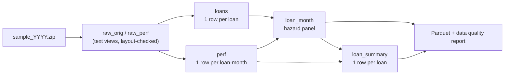

# IFRS 9 Mortgage ECL Engine

Lifetime expected credit losses for a mortgage book, built the way bank credit-risk teams build them: a competing-risks hazard model for default and prepayment, LGD and exposure models, macroeconomic scenarios, staging, and out-of-time validation. The data is Freddie Mac's public Single-Family Loan-Level Dataset: monthly performance and realised losses for US fixed-rate mortgages originated since 1999.

**Status: Phase 1 (data foundation) complete and tested on synthetic data. Next: run on the real files.**

## Quickstart

```bash
pip install -e ".[dev]"

# 1. See the whole pipeline work before downloading anything (synthetic, clearly labelled)
python -m ecl.synthetic data/synthetic --n-random 2000
python -m ecl.build --raw data/synthetic --out data/processed_synthetic --synthetic
pytest

# 2. Real data (see "Getting the data")
python -m ecl.build --raw data/raw --out data/processed --vintages 2005 2006 2007 2008 2012 2016 2019 2020 2021
```

Each build writes `ecl.duckdb` (all tables), Parquet copies of the modelling tables (readable from R with `arrow::read_parquet`), and `data_quality.md`. Copy the quality report into `reports/` to commit it; nothing under `data/` is ever committed.

## Getting the data

1. Register for free on Freddie Mac's [Clarity Data Intelligence](https://freddiemac.com/research/datasets/sf-loanlevel-dataset) and open **Data Download**.
2. Download the **sample** files, `sample_YYYY.zip` (a random 50,000 loans per vintage year), into `data/raw/`. Zips are extracted automatically.
3. Build a handful of vintages first; the full set is large once unzipped.

Freddie Mac's terms allow research use but not redistribution, so the raw data never goes into this repository.

## Pipeline



| Table | Grain | What it is for |
|---|---|---|
| `loans` | loan | Origination attributes, with "not available" codes turned into NULLs |
| `perf` | loan × month, full history | Everything Freddie Mac reports, de-duplicated; source for LGD and cures |
| `loan_month` | loan × month **at risk** | The modelling panel: `event` ∈ continue / prepay / default / other_exit, predictors lagged one month |
| `hazard_panel` (view) | as `loan_month` | `loan_month` with origination attributes attached |
| `loan_summary` | loan | Entry and exit, outcome, exposure at default, what happened after default, realised LGD |

The definitions (default, prepayment, censoring, the time axis, leakage) are in [docs/DECISIONS.md](docs/DECISIONS.md). [docs/WALKTHROUGH.md](docs/WALKTHROUGH.md) follows individual loans through every step.

## Roadmap

| Phase | Build | Done when | Hours |
|---|---|---|---|
| **1. Data foundation** ✅ | Loader, hazard panel, data quality report, 37 tests | Quality report on the real vintages committed; walkthrough exercises answered | 6–8 |
| **2. Survival baselines (R)** | Kaplan–Meier and cumulative incidence by vintage and FICO band; Cox and Fine–Gray with delayed entry | Plots and a one-page note on what drives default versus prepayment | 8–10 |
| **3a. Competing-risks MNL** | Multinomial logit on loan-months; seasoning, FICO, LTV, DTI, rate incentive | Marginal effects explained; in-sample calibration by vintage | 10–12 |
| **3b. Bayesian hierarchical MNL** | Partial pooling across vintages and states, fitted on aggregated covariate cells | Posterior predictive checks; shrinkage shown against 3a | 10–14 |
| **4. ECL engine** | Macro join (unemployment, house prices, mortgage rates); scenarios from the Fed's published stress-test paths; lifetime PD; LGD as cure versus liquidation; EAD; staging; probability-weighted ECL | ECL by stage and scenario, with credible intervals | 15–20 |
| **5. Validation** | Out-of-time backtest through COVID; Gini, KS, calibration, PSI; LightGBM challenger with SHAP | A validation report in model-validation style | 10–14 |
| **6. Decision layer and delivery** | Lending-policy simulator, FastAPI + Docker scoring service, Tableau dashboard, write-up | Live dashboard link; results summarised in this README | 15–20 |

**CV-ready first version:** Phases 1, 2, 3a and 4 (one scenario set) plus the Tableau dashboard, about 45–55 hours. Phases 3b, 5 and 6 make it the full version.

## Repository layout

```text
sql/            01_loans → 02_perf → 03_loan_month → 04_loan_summary
src/ecl/        layout.py (file layout) · ingest.py · build.py · quality.py · synthetic.py
tests/          edge cases, file handling, invariants at scale
docs/           DECISIONS.md · WALKTHROUGH.md
reports/        committed copies of generated reports
data/raw/       Freddie Mac files (git-ignored)
```
